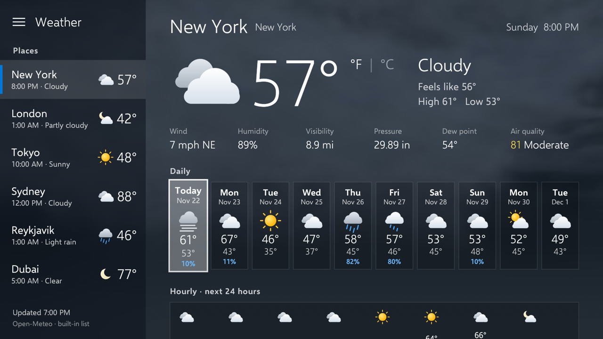
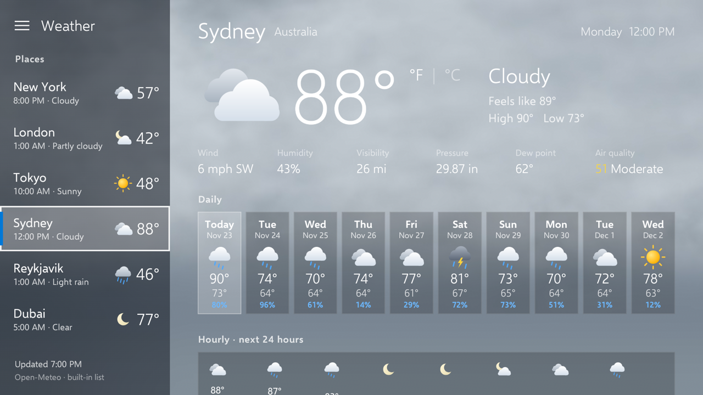
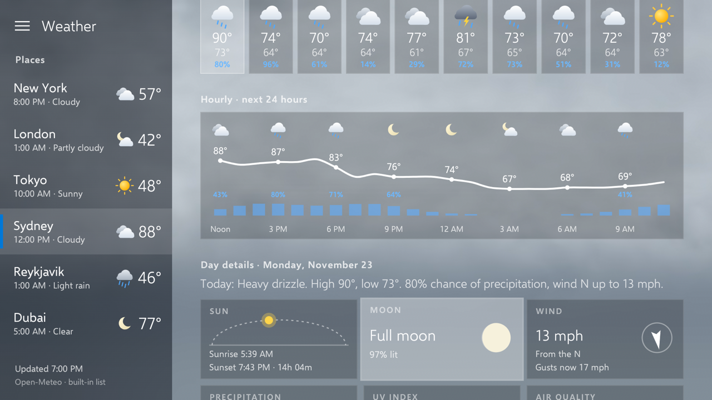

# Acrylic Weather: a Windows 10–style weather app for Android TV and Fire TV

**Ad-free, remote-first weather for the big screen.** Translucent "acrylic" tiles, a big thin
temperature, a 10-day strip, an hourly graph and day details, over animated skies that change with
the weather: drifting clouds, rain, snow, fog, stars, moonlight and lightning. Inspired by the
classic, pre-ads Windows 10 Weather app (MSN Weather). No location tracking, no account, no API
key, no ads, no analytics.

<p align="center">
  
</p>
<p align="center">
  
  
</p>

- **Built for the D-pad.** Every screen works with up, down, left, right, OK and Back. No touch,
  no pointer, no keyboard.
- **A fixed list of places**, in a sidebar like Windows 10's. The app never asks where the TV is:
  you list the cities in a small text file (up to 12), and the first one opens first.
- **Animated skies, pre-rendered.** Fourteen seamless loops (clear, partly cloudy, cloudy, fog,
  rain, snow, each by day and by night, plus a thunderstorm and golden hour), rendered with Metal on
  a Mac and played by the TV's hardware video decoder. Pick a day in the forecast and the sky turns
  into that day's weather.
- **Light on a weak TV.** About 0.3 MB of app plus 26 MB of skies, no libraries (no AndroidX,
  Kotlin, Play Services), one permission (internet). The window doesn't redraw unless you press a
  button; the whole TV is as busy as with a looping video wallpaper (measured, see below).
- **Free data:** forecasts and air quality from [Open-Meteo](https://open-meteo.com) (CC BY 4.0),
  everywhere in the world, no key needed.
- °F or °C (the `°F | °C` switch next to the temperature, like Windows 10), 12- or 24-hour clock.

## What's on screen

| Part | Shows |
|---|---|
| Sidebar | Your places, each with its local time, sky and temperature |
| Now | Temperature, conditions, feels like, today's high and low, wind, humidity, visibility, pressure, dew point, US air quality index |
| Daily | 10 days: icon, high, low, chance of rain or snow |
| Hourly | 24 hours as a temperature curve with icons and precipitation bars; the cursor reads each hour out |
| Day details | Sunrise and sunset arc, moon phase, wind, precipitation, UV index, air quality |

## Remote

| Button | Does |
|---|---|
| ▲ ▼ in the sidebar | switch places (the sky and forecast follow) |
| ▶ / OK in the sidebar | into the forecast |
| ◀ ▶ on the days | pick a day: hourly graph, day details and sky follow |
| ▼ from the days | the hourly graph; ◀ ▶ moves hour by hour |
| ▲ from the days | the `°F \| °C` switch; OK toggles |
| ☰ Menu | refresh now |
| Back | to the sidebar, then out |

## Install

You need `adb` and a TV with ADB debugging on (Fire TV: Settings › My Fire TV › Developer options).

```sh
adb connect <tv-ip>:5555
./install.sh --build places.conf     # build, install, push your places, open
```

or install `build/acrylic-weather.apk` any way you like. It shows up in the launcher as **Weather**,
with a banner for Android TV and Fire TV home screens.

### Your places

Copy [`places.example.conf`](places.example.conf) to `places.conf` and list your cities:

```
# Name | Region | latitude | longitude
Paris | France | 48.8566 | 2.3522
Tokyo | Japan | 35.6762 | 139.6503
units=imperial
clock=24h
```

Push it to `/sdcard/Android/media/io.github.vladislavekimtcov.acrylicweather/places.conf` (any
Android TV, no root: adb can write an app's media folder) and reopen the app. Coordinates:
`https://geocoding-api.open-meteo.com/v1/search?name=<city>`. Without a file it shows New York,
London, Tokyo, Sydney, Reykjavik and Dubai, and leaves a commented `places.conf.example` there.

## How it stays fast on TV hardware

Smart TVs and sticks have slow CPUs and GPUs. Measured on a Fire TV Edition television (MediaTek
MT5896, Fire OS 8 / Android 11) while building this:

- **The skies are video, not live drawing.** [`tools/sky/Sky.metal`](tools/sky/Sky.metal) renders each
  sky procedurally on a Mac GPU (fBm clouds in three parallax layers with directional light, rain
  streaks with motion blur, snow with depth, stars, a shaded moon, sun rays, fog banks, lightning).
  [`tools/sky/SkyRender.swift`](tools/sky/SkyRender.swift) pipes 16-bit frames into x265: 1080p,
  30 fps, HEVC Main10.
- **Seamless loops by construction.** Rain, snow, twinkling, sun rays, cloud morphing and lightning
  complete whole cycles per loop; only the cloud drift isn't periodic, so the last 4 seconds fade
  into the first. The step from the last frame back to the first is as small as any other frame
  step. The app loops gaplessly: at the end of the file it seeks back and keeps the timestamps
  running, without flushing the decoder.
- **Hiding compression artifacts:** 10-bit encoding (no banding in smooth gradients), x265
  `aq-mode=3` (more bits for dark flat skies, so night doesn't block up), softer deblocking, and a
  1-LSB triangular dither added on the TV when the frame is drawn.
- **Hardware decode, one GL blit.** Each sky is decoded by the TV's video chip into a
  `SurfaceTexture`, and a single textured quad draws it on its own `SurfaceView` (which also
  crossfades two skies when the weather changes). On this TV, decoding straight onto a
  `SurfaceView` is shown on a video plane that its display service never unmutes for an app, so the
  GL path is what makes it visible everywhere.
- **The window is idle.** Nothing in the translucent UI animates continuously; a redraw of the whole
  window costs ~11 ms of CPU there. Focus and entrance animations run briefly, and page sections
  that are scrolled far off screen aren't drawn at all.
- Stops decoding when the app isn't in front; refreshes the forecast every 10 minutes while open.

Measured on that TV: 0 window frames at rest; system-wide CPU with the app open is the same as
with the launcher playing a 1080p30 video wallpaper (~196% vs ~202% of one core, on a 4-core chip
whose idle baseline is already high). Drawing the same kind of sky live inside the window had
every frame janky (32 ms, 22 ms of GPU) and slowed the remote down.

## Build from source

Plain Java and the bare Android SDK tools: no Gradle.

```sh
./build.sh              # JDK 17 + Android SDK (platforms;android-25, build-tools) -> build/acrylic-weather.apk
./tests/run.sh          # host tests on a desktop JVM
# Re-render the skies (macOS with Metal, ffmpeg with libx265):
swiftc -O -o build/skyrender tools/sky/SkyRender.swift
build/skyrender tools/sky/Sky.metal assets/sky              # all, ~5 min on an M1 Pro
build/skyrender tools/sky/Sky.metal /tmp/look --still 3 storm   # one frame to look at
python3 tools/art.py    # the launcher banner (Pillow)
```

`build.sh` signs with `release.keystore` (created on the first build, git-ignored); keep it, since
updates must be signed with the same key. A sky can be swapped without rebuilding: push an MP4 to
`/sdcard/Android/media/io.github.vladislavekimtcov.acrylicweather/sky/<scene>.mp4`
(scenes: `clear-day`, `clear-night`, `partly-day`, `partly-night`, `cloudy-day`, `cloudy-night`,
`fog-day`, `fog-night`, `rain-day`, `rain-night`, `snow-day`, `snow-night`, `storm`, `dusk`).

## Privacy

The only network traffic is the forecast request to `api.open-meteo.com` and
`air-quality-api.open-meteo.com` with the coordinates of the places you listed. No location
permission, no identifiers, no analytics, no crash reporting.

## Credits

- Weather data: [Open-Meteo.com](https://open-meteo.com), CC BY 4.0.
- Type: [Selawik](https://github.com/microsoft/Selawik), Microsoft's open-source Segoe UI fallback,
  SIL Open Font License 1.1 ([`assets/fonts/OFL.txt`](assets/fonts/OFL.txt)).
- Look and feel inspired by Windows 10's Weather app. Not affiliated with Microsoft or MSN.

MIT licensed. See [LICENSE](LICENSE).
